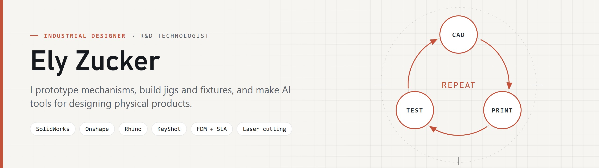

  <picture>
    <source media="(prefers-color-scheme: dark)" srcset="assets/banner-dark.jpg">
    
  </picture>

  
  

## About

I'm an industrial designer who works close to the hardware, with 8+ years of hands-on work. I take a product mechanism from sketch to tested prototype: CAD, print, test, repeat. Then I build the jigs and fixtures that make it repeatable on an assembly line.

Lately I also build AI tools that help design and manufacture physical products.

## Toolbox

| Area | Tools |
| --- | --- |
| **CAD and rendering** | SolidWorks · Onshape · Rhino · KeyShot · Vizcom · Meshmixer |
| **Fabrication and testing** | FDM and SLA printing · laser cutting · jigs and fixtures · functional testing |
| **Design** | Industrial design · CMF · concept modelling · 3D scanning · Adobe Creative Cloud |
| **AI and code** | Claude Code · Cursor · Google Antigravity |

## Currently exploring

- **Cross-polarization 3D scanning** of glossy and reflective objects.
- **AI tools for making things**: design rules, manufacturing checks and CAD automation that an AI assistant can actually run.

## Get in touch

The best way to reach me is [LinkedIn](https://www.linkedin.com/in/elyzucker/).
